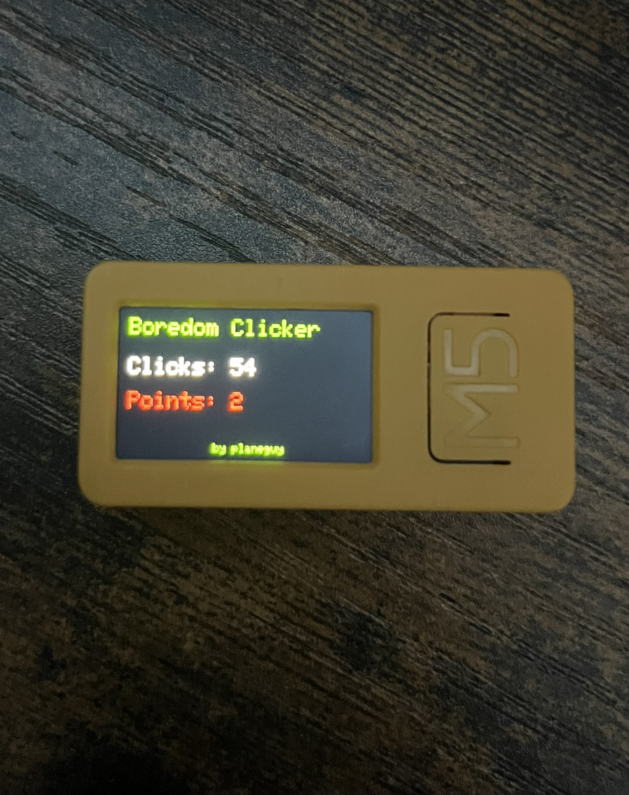

# Boredom-Clicker-M5StickCPlus2
A small basic program I made for the M5 Stick CPlus2. It is a simple clicker game where clicks create sounds and are counted. Points also get awarded randomly through clciks.

There is not too much to say about this project. The main button on the stick is used as the click button, the top button is used to reset the clicks and points and the bottom button is used to power on and off the device. I created this mainly because my stick was collecting dust due to me having better devices that I prefer to use for projects. This is the first time I have uploaded a project and I will likely upload more of mine in the future.
